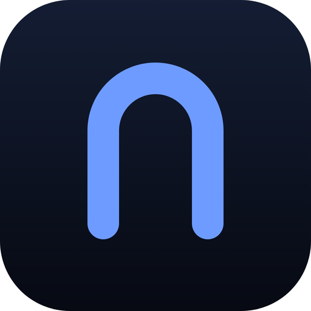

# <picture><source media="(prefers-color-scheme: dark)" srcset="docs/references/badges/openchamber-logo-dark.svg"></picture> OpenChamber · Чамбэрлейн

**🌐 Языки: [Русский](README-RU.md) · [English](README.md)**

> [!NOTE]
>  **Это Чамбэрлейн (Chamberlain) — форк OpenChamber для командной работы.** Он надстраивает над апстримом один цельный блок возможностей, у каждой — своя поверхность. [Read in English](README.md)
>
> - **Режим команды.** Ведущий, с которым вы переписываетесь, и нанятые сослуживцы: общая доска задач со значками пул-реквестов, живой ростер, подкоманды и единая лента активности.
> - **Миссии.** Страница «Цели»: промпт-цель попадает в размеренную очередь и выполняется новой сессией или командой под ведущим, от старта до результата.
> - **Контакты. Сохранённые персонажи-ассистенты** (ревьюер, планировщик), у каждого один непрерывный чат, в один клик из сайдбара.
> - **Поверхности ревью.** Bitbucket DC, Jira и Confluence только для чтения: пул-реквесты и задачи открываются полноценными панелями, отдельная сессия разбирает пул или собирает спецификацию, а методологию оценки задают настройки Magic Prompts.
> - **Отладка Python.** Точки останова в гуттере `.py`-файла, стрелка запуска на функциях верхнего уровня, панель отладки со стеком, переменными, шагами и вычислением выражений — и переменную из остановленного кадра можно приложить прямо к сообщению в чате.
> - **Рабочее пространство, которое вы собираете сами.** Панели-регионы вокруг чата: пристыковать, открепить, передвинуть по дереву раскладки — доска ревью и трекер рядом с разговором.
> - **Движки как файлы.** Модельные движки регистрируются файлами-дескрипторами, а папка сессий задаёт агента, на котором начинают новые чаты.
> - **`/compactnew`.** Сжать длинный чат и продолжить в новом, засеянном выжимкой старого.
> - **Русский целиком.** Локаль `ru` несёт каждый ключ, что поставляет апстрим.
>
> Релиз форка: [`2.4.0-fork2`](../../releases/tag/v2.4.0-fork2) на базе апстрима `2.4.0` — сборки для macOS приложены к релизу как `Chamberlain-*.dmg`. Приложение ставится рядом со стоковым OpenChamber, под своим именем и значком. Полная история по коммитам: [README-FORK.md](README-FORK.md).

## Что форк добавляет поверх официального OpenChamber

Каждое наименование — ссылка на отдельную статью со скриншотами; подпункты перечисляют, что именно оно умеет. [The same list in English](README.md#what-the-fork-adds-over-upstream-openchamber).

- [Режим команды](docs/fork-features/team-mode.md#русская-версия) — ведущий, с которым вы переписываетесь, плюс нанятые сослуживцы.
  - диалог создания команды с встроенными и своими пресетами; пресеты экспортируются и импортируются JSON, живая команда выгружается рецептом в один клик;
  - живой ростер с устойчивыми цветами-идентичностями, правится на ходу работающей команды; подкоманды (аналитика, разработка, ревью, QA) — у каждой свой ведущий;
  - одна общая доска задач с группировкой по статусу, участнику или подкоманде; быстрое заведение, задача из выделения в чате, состояние пул-реквеста прямо на задаче (черновик, вливаемость, вердикт CI) через 60-секундный кеш;
  - завершённая задача обязана предъявить доказательства — результат или ссылку на пул-реквест, иначе завершение отклоняется; дедлайны задач с однократным уведомлением о просрочке; всё переживает рестарты;
  - грани **«Чаты»** и **«Активность»**: параллельные колонки чатов по одной на участника и одна постраничная лента жизни команды.
- [Миссии](docs/fork-features/missions.md#русская-версия) — страница **«Цели»**, которая сама расставляет заявленное по очереди.
  - промпт-цель выполняется новой одиночной сессией или первой задачей ведомой команды;
  - размеренная очередь: от 1 до 16 полос, окно наблюдения от 1 до 1440 минут, карточка настроек на странице; повтор, отмена, удаление, прыжок в рабочую сессию; переживает рестарты.
- [Контакты](docs/fork-features/contacts.md#русская-версия) — сохранённые персонажи-ассистенты в сайдбаре.
  - персона — имя, описание, промпт (+ модель, + агент) на карточке адресной книги;
  - у каждого контакта один непрерывный чат; если чат удалили, новая нить стартует, засеянная персоной первым сообщением.
- [Отладка Python](docs/fork-features/python-debugging.md#русская-версия) — настоящий отладчик в редакторе, где код и так открыт.
  - клик по гуттеру ставит точку останова в любом `.py`-файле; на каждой функции верхнего уровня растёт стрелка запуска — скрипты стартуют собой, тесты под pytest со своим node id; настроенные точки едут с каждым запуском;
  - панель отладки: стек вызовов с текущим кадром, шаг через / в / из, продолжение, остановка, дерево переменных с копированием, вычисление любого выражения в остановленном кадре, живые stdout и stderr;
  - pytest-репортер сворачивает в лог прогона собранные узлы, статусы по тестам и трейсбеки — один прогон отвечает и на «прошёл ли», и на «почему нет»;
  - **переменная остановленного кадра прикладывается к чату** как полноценная контекст-часть: точечный путь, тип значения, место остановки и само значение;
  - одна настройка задаёт интерпретатор; оставьте пустой — и выигрывает `.venv` самого проекта; форма запуска правится из панели; переведено во всех поставляемых локалях.
- [Папка сессий выбирает своего агента](docs/fork-features/session-folder-agents.md#русская-версия) — папки, знающие, кому отвечать.
  - в настройках папки агент выбирается один раз; каждый новый чат, заведённый внутри, стартует на нём;
  - это дефолт, а не клетка: любой чат по-прежнему можно переключить на другого агента, а переезд из папки снимает привязку.
- [Анализ пул-реквестов](docs/fork-features/pull-analysis.md#русская-версия) — выделенные сессии, которые разбирают пул, чтение за чтением.
  - два разбора из шапки пула: анализ комментариев взвешивает каждую открытую нить против её строки и файла; анализ файлов держит дифф против задачи из заголовка (ключ тянется из Jira);
  - ответ: сноски на открытых комментариях, вердикт-чипы на файлах, общий вердикт — сначала читаемый текст, машинный дайджест для панелей свёрнут в хвосте;
  - повторное чтение везёт дайджест предшественника и пересудивает целиком; вкладка «обзор» перечисляет все чтения пула, каждое открывает свою сессию;
  - методология оценки — редактируемая настройка **Magic Prompts** с переопределениями на каждое чтение и сбросом к дефолту;
  - поверхность **доски ревью** отвечает «что от меня нужно сейчас»: открытые пулы аккаунта, отсортированные по вердикту последнего чтения, сначала замечания, рядом — спринтовые задачи Jira.
- [Bitbucket Data Center](docs/fork-features/bitbucket.md#русская-версия) — пул-реквесты, прочитанные целиком, строго только для чтения.
  - вставьте URL пула или выберите из списка открытых; поиск по id, заголовку, автору или репо; секция «недавно читанные»;
  - табы: обзор, комментарии с ответами, коммиты, изменения; «изменения» — интерактивный дифф, чья кнопка «спросить» вырывает в композер цитату ±12 строк;
  - люди носят настоящие аватарки через прокси сервера; PAT не покидает сервер, и пути записи на инстанс в форке нет нигде.
- [Jira Data Center](docs/fork-features/jira.md#русская-версия) — задачи, вылеченные и о которых спрашивают.
  - поверхность задач с обзором, описанием, комментариями, историей, связями и вложениями; шум инстанса вылечен: имена спринтов вместо сериализации, счётчики Development, спрятанные ключи ранжирования;
  - описания рендерятся как их нарисовала Jira; **«Спросить»** пришпиливает задачу к композеру; напечатанные в чате ключи задач сами становятся чипами; префиксный поиск `assignee:`, `reporter:`, `status:`, `project:`;
  - **карточка спецификации** на теле задачи: сессия пишет спецификацию разработки — суть, план, привязанный к вашему репозиторию, приёмка, открытые вопросы, вне охвата — и следует за ответом живьём.
- [Confluence](docs/fork-features/confluence.md#русская-версия) — страницы рядом с разговором.
  - поверхность страниц читает и ищет Confluence DC, список «недавно читанных» помнит, где вы были; чип **«Спросить об этой странице»** пришпиливает её слова к композеру;
  - страница может ехать брифом: диалог анализа пула и сборка спецификации задачи получают пикер страницы, и страница въезжает в чтение собственной секцией.
- [Движки как файлы](docs/fork-features/engines.md#русская-версия) — модельные движки регистрируются дескриптором.
  - `engine.json`, положенный в каталог, появляется в реестре за секунды — без правок кода и рестарта хоста;
  - версионируемый словарь возможностей решает, кто служит в основном чате и во что вырождается поверхность без возможности — с показанными причинами; read-only эндпоинты реестра.
- [Рабочее пространство, которое вы собираете сами](docs/fork-features/workspace-regions.md#русская-версия) — регионы вокруг чата, а не одна колонка панели.
  - у каждой директории своё дерево раскладки: табы файла, диффа, терминала, отладки, git, браузера, команды и ревью сидят в передвижных, ресайзимых регионах;
  - закрытый регион оставляет табы в полосе, клик по рельсе ставит их снова; поверхности форка входят в дерево remount-панелями с едиными ширинами;
  - запуск отладки, начатый вне панели, сам отрезает себе регион рядом с запускаемым файлом.
- [/compactnew](docs/fork-features/compactnew.md#русская-версия) — длинный чат, свежее начало.
  - `/compactnew` в слэш-меню композера сжимает чат и продолжает в новом, засеянном выжимкой; старый чат остаётся в списке архивом.
- **Русский целиком.** Локаль `ru` несёт каждый ключ форка и апстрима — все 16 поставляемых локалей в паритете.

## Запускайте работу агентов. Сохраняйте контроль. Отгружайте откуда угодно.

**OpenChamber — рабочее пространство с открытым кодом для запуска и ревью ИИ-работы над кодом: десктоп, веб, VS Code и мобильные.**

Стартуйте работу агента, смотрите что изменилось, проводите её через ревью и релиз. Проекты и сессии остаются доступны, когда вы меняете устройство или отходите от компьютера.


<details>
<summary>Ещё скриншоты</summary>


<p>


</p>

</details>

## Режим команды — команда агентов под присмотром одной панели

Режим команды превращает сессии в укомплектованную команду: **ведущий**, с которым вы
переписываетесь, и сослуживцы, каждый со своей ролью. Ведущий раскладывает работу на
общую доску, сослуживцы разбирают задачи, отчитываются, и каждый шаг виден из
привычного вам чата.

<p>


</p>

### Команда в одном диалоге

Начните с **пресета** — встроенных составов (инженерная бригада, аналитики, дуэт) или
своих сохранённых ростеров — или соберите пустую команду. Каждый участник получает
имя, бриф роли, агента, модель и, по желанию, скиллы и MCP-серверы. Первая задача,
если задана, делегируется ведущим сразу после старта команды.
[Подробнее](README-FORK.md#team-mode-core--faa3ab9-480cdfa)


### Живой ростер

Панель рабочего состояния обрастает секцией **Команда**: каждый участник с его живым
состоянием (стартует, занят, простаивает, упал) и устойчивым цветом-идентичностью,
общим для ростера, доски и ленты активности. Ростер живой команды можно править —
добавлять участников, менять брифы, убирать — и объединять их в **подкоманды**
(аналитика, разработка, ревью, QA), каждая со своим ведущим.
[Подробнее](README-FORK.md#sub-teams-and-live-roster-editing--644f61d)


### Общая доска задач

Одна доска на всю команду — задачи с темой, брифом, владельцем и цепочкой
блокировок, сгруппированные **по статусу, по участнику или по подкоманде**. Завести
задачу можно быстрым добавлением или прямо из выделения в чате действием
**«Задача команде»**. Проставьте `prUrl`, и карточка сама отвечает за свой
пул-реквест: черновик или открыт, можно ли влить, зелёный или падающий CI — данные
обновляются с GitHub. [Подробнее](README-FORK.md#task-details-and-portable-presets--4fe541e-30bd143-9e58674)


### Попросите ведущего подобрать роль

Нужен «кто-нибудь поревьюить диффы на французском», но непонятно, какой агент
подойдёт? Спросите ведущего из ростера — он предложит конкретного агента с брифом,
а вы подтвердите или поправите, прежде чем кто-то присоединится.
[Подробнее](README-FORK.md#ask-the-lead-to-staff--5c96ebd)

### Активность команды в одной ленте

Сообщения, записи в задачи, изменения пул-реквестов — вся жизнь команды в общей
ленте с постраничной прокруткой и цветами участников, плюс грань **Чаты**,
отражающая переписку каждого участника.
[Подробнее](README-FORK.md#the-activity-face--c79d405)

## Миссии — цели, которые встают в очередь сами

Страница **Цели** в сайдбаре: заведите промпт-цель, выберите, как выполнять —
новая **одиночная сессия** или ведомая **команда**, для которой это первая задача, —
и уходите. Очередь ведёт две цели одновременно, следит за каждой рабочей сессией до
завершения и переживает рестарты. Повтор, отмена или переход в рабочую сессию прямо
из списка. [Подробнее](README-FORK.md#missions-goals-filed-into-a-paced-queue--7695098)


## Контакты — ассистенты, которых держат как людей

Страница **Контакты** рядом с Целями: сохраните ассистента как персонажа — имя,
чем занимается, промпт, который его определяет, при желании модель и агента. У
каждого контакта один чат, и он остаётся одним: открываете контакт — продолжается
та же нить; если нить удалили, контакт заводит новую, засеянную его персонажем, и
отвечает в сохранённой роли с первого же сообщения.
[Подробнее](README-FORK.md#contacts-saved-personas-with-one-continuing-chat--2e95232c9)

<p>


</p>

## /compactnew — длинный чат, свежее начало

`/compact` сжимает длинный чат на месте; `/compactnew` сжимает его и
**продолжает в новом чате**, засеянном выжимкой. Старый чат остаётся в списке как
архив. [Подробнее](README-FORK.md#compactnew-continues-a-long-chat-in-a-fresh-one--eb2fa71)

## Bitbucket DC и Jira — целые панели, выверенные разборы, ваша методология

Подключите свой **Bitbucket Data Center** и **Jira** с PAT в настройках — всё
только для чтения, токен не покидает сервер. Пул-реквест открывается полной
панелью: метаданные, проверки, ревьюеры, открытые комментарии с привязкой к файлу и
строке, пофайловые диффы. Задача Jira приходит аккуратной карточкой, шум инстанса
вылечен: спринты показывают имена, а не сериализацию Greenhopper; Development
показывает счётчики dev-summary; ключи ранжирования спрятаны.

Два разбора идут на выделенных сессиях. **Разбор пул-реквеста**: каждый открытый
комментарий отращивает сноску (суть, обоснован ли, как починить), каждый файл —
вердикт, пул в целом — общий вывод. **Спецификация из задачи Jira**: суть, план,
заземлённый на ваш репозиторий, проверяемые критерии приёмки, открытые вопросы,
границы — обратно на карточке задачи. Каждый ответ — сначала читаемый текст, в
хвосте свёрнутый машинный дайджест; а инструкции оценки, с которых начинаются оба
разбора, **можно править** в настройках Magic Prompts.

[Подробнее](README-FORK.md#bitbucket-data-center-read-whole-pull-requests-in-the-panel--0596c7fb8-d81078bbf)

## Отладка Python — там же, где код

В `.py`-файле полоска слева от номеров строк принимает клик: появляется точка
останова. На функциях верхнего уровня растёт стрелка запуска: скрипт запускается
сам собой, тест — под pytest со своим node id, настроенные точки останова едут
рядом. Панель отладки читает одну DAP-сессию debugpy: стек и кадры, шаги over,
into и out, продолжение и остановка, дерево переменных с копированием, поле
вычисления выражений в остановленном кадре, живой вывод и статусы pytest в логе
прогона. Переменную можно приложить к сообщению в чате — с точечным путём, типом
и местом остановки. Интерпретатор — настройка; пустое значение отдаёт выбор
`.venv` самого проекта.

## Что умеет OpenChamber

### Цели, которые доводят себя сами

Дайте сессии финишную черту через **Цели сессии**. OpenChamber проверяет результат
после каждого хода и держит агента за работой, пока цель не выполнена, не упёрлась
в блок или не достигнут заданный лимит. Может продолжать и после того, как вы
закрыли приложение.

### Сравнивайте и объединяйте прогоны

**Мультипрогон** даёт одну задачу до пяти моделям, каждая в своей сессии и, по
желанию, в своём ворктри. Посмотрите, что каждый реально собрал, выберите лучшее
или соедините сильные части через **Fusion** в новую сессию.

### Проводник по изменениям

**Проводник изменений** превращает большой дифф в экскурсию по правке с ИИ-гидом:
группирует связанные правки в шаги, выстраивает их в порядок, в котором правка
логична, и объясняет, как части сходятся вместе.

### Осмотрите работающее приложение

Откройте приложение рядом с разговором через **Preview**. Укажите на элемент —
агент получит скриншот, стили, позицию и ошибки браузера. Больше не нужно
объяснять «вот эту штуку». Десктоп умеет то же с любой веб-страницей во встроенном
браузере.

### Контекст GitHub от задачи до пул-реквеста

Начните сессию с задачей или пул-реквестом GitHub, приложив их контекст.
Возвращайте агенту упавшие проверки и комментарии ревью, обновляйте или вливайте
пул-реквест прямо из OpenChamber.

### Продолжение на другом устройстве

Открывайте те же проекты и сессии с десктопа, веба/PWA, VS Code, iOS или Android.
Проверяйте прогресс, отвечайте на вопросы, ревьюьте изменения и подсоединяйтесь к
работающему терминалу.

### Приватный удалённый доступ

Спарьте устройство одноразовым QR-кодом и подключайтесь через **Private Relay**
без открытых портов и публичного сервера. Соединение шифруется end-to-end, его
можно отозвать в любой момент. Поддерживаются и прямые соединения, доступ по
LAN/VPN, туннели Cloudflare/Ngrok и SSH.

### Следите за работой между проектами

Видно, какие сессии работают, ждут, закончены или упали, плюс подтверждения,
запланированные задачи, лимиты провайдеров, расход токенов и стоимость. Сессии
раскладываются по папкам, рядом заметки, тудушки и переиспользуемые действия
проекта.

### Планируйте повторяющуюся работу

Запустите промпт один раз, ежедневно, еженедельно или по cron. Запланированные
задачи умеют Цели сессии и продолжают идти к результату, а не останавливаются
после первого ответа.

## Работайте там, где работаете

| Поверхность | Роль |
| --- | --- |
| **Десктоп** | Полное рабочее пространство для macOS, Windows и Linux: несколько окон, Mini Chat, удалённые машины, SSH и системные уведомления |
| **Веб / PWA** | Открывайте рабочее пространство в браузере, устанавливайте как приложение и получайте фоновые уведомления |
| **VS Code** | Держите сессии рядом с кодом, отправляйте агенту выделения, открывайте результаты в редакторе и сравнивайте параллельные прогоны |
| **iOS / Android** | Ревьюьте и направляйте работу вне стола, получайте оповещения о завершении и работайте с терминалом сенсорными кнопками |
| **CLI / Сервер** | Запускайте OpenChamber на рабочей станции или сервере, планируйте задачи, управляйте удалённым доступом и держите его живым после логина |

## Быстрый старт

### Десктоп для macOS, Windows и Linux

Скачайте свежий релиз со страницы [GitHub Releases](https://github.com/openchamber/openchamber/releases/latest). Десктоп несёт подходящий OpenCode CLI внутри, отдельная установка OpenCode не нужна.

Релизы Linux приходят под x86_64 и ARM64 в виде `.deb` (Debian, Ubuntu), `.rpm`
(Fedora, openSUSE) и AppImage. Пакеты ставят OpenChamber в меню приложений, а
обновления изнутри приложения просят пароль для установки нового пакета:

```bash
sudo apt install ./OpenChamber-*-linux-amd64.deb    # Debian, Ubuntu
sudo dnf install ./OpenChamber-*-linux-x86_64.rpm   # Fedora
```

AppImage не требует установки. Дайте право на исполнение и держите его в месте,
доступном для записи, чтобы работали обновления; при первом старте он сам
добавит себя в меню приложений:

```bash
chmod +x OpenChamber-*.AppImage
./OpenChamber-*.AppImage
```

AppImage под Linux требует FUSE (`libfuse.so.2`). Без FUSE запускайте с
`APPIMAGE_EXTRACT_AND_RUN=1`.

Для сборки форка **Chamberlain** под macOS используйте DMG из релизов этого
репозитория: `Chamberlain-*.dmg`. Приложение подписано ad-hoc и не нотаризовано;
при первом запуске macOS может его не пустить — один раз «правый клик → Открыть»
или выполните `xattr -dr com.apple.quarantine "/Applications/Chamberlain.app"`
после переноса в Applications. Chamberlain ставится рядом со стоковым OpenChamber
под своим именем и значком, оба живут на одной машине.

### VS Code

Установите [OpenChamber из Visual Studio Marketplace](https://marketplace.visualstudio.com/items?itemName=fedaykindev.openchamber) или найдите «OpenChamber» в расширениях.

### CLI для веба и PWA

Требуется Node.js 24.14+. CLI/веб и VS Code используют ваш установленный
[OpenCode CLI](https://opencode.ai).

```bash
curl -fsSL https://raw.githubusercontent.com/openchamber/openchamber/main/scripts/install.sh | bash
openchamber --ui-password be-creative-here
```

Основные операции:

```bash
openchamber status
openchamber connect-url --qr
openchamber tunnel start --provider cloudflare --mode quick --qr
openchamber startup enable
openchamber logs
openchamber stop
openchamber update
```

OpenChamber по умолчанию слушает только localhost. Используйте `--lan` только в
доверенной сети и защищайте доступ браузера паролем `--ui-password`.

## Гайды

Углубляйтесь с гайдами OpenChamber:

- [Быстрый старт](packages/docs/content/docs/quickstart.mdx)
- [Установка](packages/docs/content/docs/install.mdx)
- [Подключение устройств](packages/docs/content/docs/connect-devices.mdx)
- [Private Relay](packages/docs/content/docs/private-relay.mdx)
- [Мультипрогон](packages/docs/content/docs/multi-run.mdx)
- [Цели сессии](packages/docs/content/docs/session-goals.mdx)
- [Проводник изменений](packages/docs/content/docs/walkthrough.mdx)
- [Preview и dev-серверы](packages/docs/content/docs/preview.mdx)
- [GitHub-воркфлоу](packages/docs/content/docs/github.mdx)
- [Мобильные устройства](packages/docs/content/docs/mobile.mdx)
- [Безопасность](packages/docs/content/docs/security.mdx)
- [Устранение неполадок](packages/docs/content/docs/troubleshooting.mdx)

Детали самостоятельного хостинга — в [гайде по обратному прокси](docs/REVERSE_PROXY.md). Авторинг своих тем — в [гайде по кастомным темам](docs/CUSTOM_THEMES.md).

## Почему OpenCode?

OpenChamber использует [OpenCode](https://opencode.ai) для запуска
агентов. Он выбран, потому что имеет открытый код, надёжный API и легко
расширяется.

Остальной воркфлоу берёт на себя OpenChamber. Вы решаете, что попробовать, держите
агента в русле, ревьюите результат, подключаетесь с другого устройства и
отгружаете правку.

OpenChamber — независимый проект и не связан с командой OpenCode.

## Участие

Багфиксы и мелкие улучшения — приветствуются как PR. Фичи и изменения поведения
начинаются в [обсуждении Ideas](https://github.com/openchamber/openchamber/discussions/categories/ideas),
чтобы договориться о продукте до того, как кто-то напишет код. Прочитайте
[CONTRIBUTING.md](./CONTRIBUTING.md) перед PR: там установка, контракт ревью и что
случается с большими незапланированными PR. Правила работы с документацией — в
[`packages/docs`](packages/docs/README.md).

Баги — в [issues](https://github.com/openchamber/openchamber/issues/new/choose).
Вопросы — в [обсуждениях Q&A](https://github.com/openchamber/openchamber/discussions/categories/q-a).

## Благодарности

Особая благодарность:

- [OpenCode](https://opencode.ai) — за API и открытую архитектуру, на которой построен OpenChamber
- [Pierre](https://pierrejs-docs.vercel.app/) — за вьюер диффов и подсветку синтаксиса
- Команде [T3 Code](https://github.com/pingdotgg/t3code) — за их браузерный адаптер для [libghostty-vt](https://github.com/ghostty-org/ghostty), на котором построен наш терминал
- [Юлии Ивашко](https://github.com/yulia-ivashko), собравшей праздничный фейерверк, который играет при каждом успешно запушенном коде
- Всем, кто присылал код, сообщал об ошибках и делился идеями

## Лицензия

MIT
