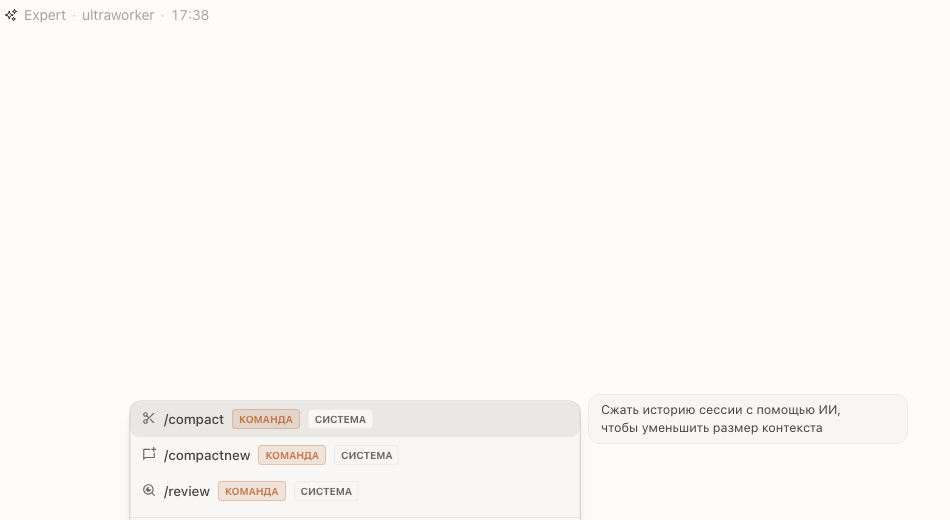

# /compactnew — long chat, fresh start

`/compact` compacts a long chat in place; this fork adds `/compactnew`,
which compacts it and **continues in a fresh chat** seeded with the summary.
The old chat stays in the list as the archive: nothing is lost, and the new
thread starts with a short context and a clear head.

[Русская версия](#русская-версия)

A year-long debugging thread slows every turn down with its own history;
compact it, continue in the fresh chat, and open the archive only when you
need what was said months ago.

---

# Русская версия

# /compactnew — длинный чат, свежее начало

`/compact` сжимает длинный чат на месте; этот форк добавляет `/compactnew`,
который сжимает его и **продолжает в новом чате**, засеянном выжимкой.
Старый чат остаётся в списке как архив: ничего не теряется, а новая нить
начинает с коротким контекстом и ясной головой.

[English](#compactnew--long-chat-fresh-start)

Годовая отладочная нить тормозит каждый ход собственной историей; сожмите
её, продолжайте в новом чате, а архив открывайте, когда нужно то, что
говорили месяцы назад.

