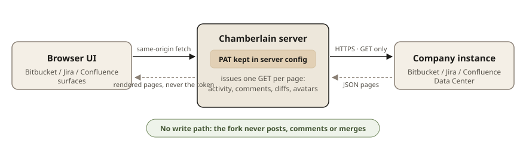

# Confluence — pages beside the conversation

One more read-only integration: connect Confluence Data Center with a PAT
in settings, and the panel grows a **pages surface**. Every call is a GET;
the token never leaves the server.

[Русская версия](#русская-версия)

## The pages surface

- Paste a page link or id, or search by words; a recently-read rowlist
  remembers where you were.
- A page reads whole — header facts, the rendered body, external links —
  capped at what the reader holds, with an honest line when «the rest
  stayed on the Confluence side».
- **Ask about this page** pins its words to the composer as a context chip
  — the text a person would paste, not the storage tags.

## A page can ride along as the brief

The analysis dialog of a pull and the spec compose of an issue both grow a
page picker. The chosen page is fetched fresh at the moment the reading
starts and embedded as its own section, with the frame the reading needs:
treat it as the task's context; where it and the issue text disagree, the
conflict is named in the open questions, never resolved in silence.

## The security shape

---

# Русская версия

# Confluence — страницы рядом с разговором

Ещё одна интеграция только для чтения: подключите Confluence Data Center с
PAT в настройках — и панель отращивает **поверхность страниц**. Каждый
вызов — GET; токен не покидает сервер.

[English](#confluence--pages-beside-the-conversation)

## Поверхность страниц

- Вставьте ссылку на страницу или id, или ищите по словам; список
  «недавно читанных» помнит, где вы были.
- Страница читается целиком — факты шапки, отрендеренное тело, внешние
  ссылки — с потолком на том, что держит читалка, и честной строкой, когда
  «остальное осталось на стороне Confluence».
- **Спросить об этой странице** пришпиливает её слова к композеру чипом
  контекста — текст, который вставил бы человек, а не теги хранилища.

## Страница может ехать брифом

Диалог анализа пул-реквеста и сборка спецификации задачи оба отращивают
пикер страницы. Выбранная страница подтягивается свежей в момент старта
чтения и встраивается собственной секцией, с нужным чтению обрамлением:
относиться к ней как к контексту задачи; где она расходится с текстом
задачи — назвать конфликт в открытых вопросах, а не разрешать его молча.

## Модель безопасности

