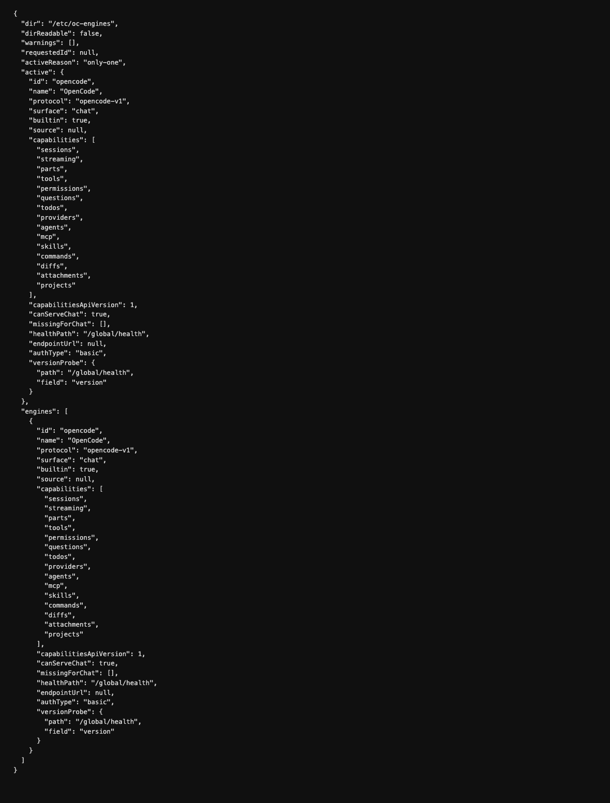

# Engines as files — the registry by descriptor

An agent engine is a file now. Drop an `engine.json` into `OC_ENGINES_DIR`
(default `/etc/oc-engines`) and the registry lists, resolves and probes it —
no code change, no host restart, roughly ten seconds to show up. Upstream
speaks only to its bundled OpenCode; the descriptor registry is this
fork's.

[Русская версия](#русская-версия)

## What an engine is

```json
{
  "name": "example-engine",
  "version": "1.0.0",
  "capabilities": { "sessions": true, "streaming": true },
  "endpoint": { "url": "http://127.0.0.1:8080" }
}
```

A closed, versioned **capability vocabulary** decides who can serve the
main chat (`sessions` + `streaming`) and what the surface degrades to when
a capability is missing — with reasons shown, not silent breakage.

## What the registry does

- **Lists, resolves, probes** every descriptor in the directory, at start
  and on demand.
- An active engine that declares its own `endpoint.url` reroutes all
  engine traffic through the one URL seam the code asks "where is the
  engine" through.
- The built-in `opencode` stays listed and serving by default — the
  `OC_ENGINE` variable (or the single-descriptor case) picks an
  alternative. With several present, alphabetical order never decides.
- A broken descriptor degrades to a warning; it never takes the registry
  down.

## The read-only endpoints

- `GET /api/openchamber/engines` — the whole registry, descriptors and
  probe verdicts.
- `GET /api/openchamber/engines/active?refresh=1` — the engine serving
  right now; `?refresh=1` bypasses the caches.
- `/health` grew `engine` / `engineRegistry` fields.



---

# Русская версия

# Движки как файлы — реестр по дескрипторам

Агентный движок теперь файл. Положите `engine.json` в `OC_ENGINES_DIR` (по
умолчанию `/etc/oc-engines`), и реестр покажет, разрешит и проверит его —
без правок кода и рестарта хоста, примерно десять секунд до появления.
Апстрим говорит только со своим встроенным OpenCode; реестр по
дескрипторам — работа этого форка.

[English](#engines-as-files--the-registry-by-descriptor)

## Что такое движок

```json
{
  "name": "example-engine",
  "version": "1.0.0",
  "capabilities": { "sessions": true, "streaming": true },
  "endpoint": { "url": "http://127.0.0.1:8080" }
}
```

Закрытый версионируемый **словарь возможностей** решает, кто может служить
в основном чате (`sessions` + `streaming`) и во что вырождается поверхность,
когда возможности нет — с показанными причинами, а не тихой поломкой.

## Что делает реестр

- **Перечисляет, разрешает и пробует** каждый дескриптор в каталоге — на
  старте и по требованию.
- Активный движок со своим `endpoint.url` перенаправляет весь движковый
  трафик через тот единственный URL-шов, через который код спрашивает
  «где движок».
- Встроенный `opencode` остаётся в списке и служит по умолчанию —
  переменная `OC_ENGINE` (или единственный дескриптор) выбирает
  альтернативу. При нескольких присутствующих алфавитный порядок ничего не
  решает.
- Сломанный дескриптор вырождается в предупреждение; он никогда не валит
  реестр.

## Эндпоинты только для чтения

- `GET /api/openchamber/engines` — весь реестр: дескрипторы и вердикты
  проб.
- `GET /api/openchamber/engines/active?refresh=1` — движок, служащий прямо
  сейчас; `?refresh=1` обходит кеши.
- `/health` оброс полями `engine` / `engineRegistry`.


