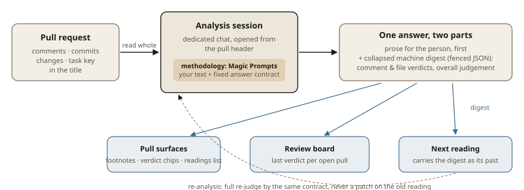

# Pull analysis — judged readings, your methodology

Two readings run on dedicated sessions, opened from the pull's header, and
the instructions both open with are **yours to edit**. Upstream reviews
diffs; it has no analysis sessions, no readings, no methodology settings —
this is the fork's work.

[Русская версия](#русская-версия)

## The two readings

- **The comments analysis** reads only the open threads and weighs each
  note against its own line and file, proposing what would settle it when
  the note is fair.
- **The files analysis** holds the diff against the task the pull title
  names — the key fetched from Jira when it reads, an honest look at the
  title alone when it does not.

Every open comment grows a footnote (gist, is it justified, how to fix);
every file a verdict chip; the pull an overall verdict.

## The answer is two-part, on purpose

Each answer is readable prose first, for the person, with a collapsed
**machine digest** tail — the compact fenced JSON the panels read: footnote
chips, file verdicts, the overall judgement. The chat folds the digest
into one collapsed line; panels keep working off the raw text, so an
edited methodology can never edit the panel out of working.

## A pull remembers its readings

Starting an analysis again does not start blind: the fresh reading carries
a machine digest of the previous one — its comment and file verdicts, its
overall judgement — framed for what it is, one reading's past opinion. The
model is told to re-judge in full: what the pull fixed since, what still
stands, a whole new reading by the same contract, never a patch on the
old one.

The overview tab lists **every reading** of the pull, newest first, each
opening its own session.

## The methodology is a setting

The judging instructions both readings open with live in **Magic Prompts**
settings, under an Integrations group: default templates, per-reading user
overrides, reset to default. The app always appends the material and the
answer contract on its own, so no edited text can break the contract; the
task instruction keeps one slot, `{{task_instruction}}`, filled from the
pull title's task key.

## The review board answers «what needs me next»

One more surface on the rail: the open pulls of the connected Bitbucket
account, each carrying its last reading's verdict — concerns first,
questions next, approvals after them, reads without a parsed verdict, and
the unread tail — with the Jira field beside them for the sprint's issues.

- A verdict comes from the reading's own answer, parsed by the same
  contract the pull body trusts; a reading still turning says so.
- A row's click is a handoff: the pull or issue opens on exactly that item,
  consumed once at the opening, never replayed later.

---

# Русская версия

# Анализ пул-реквестов — выверенные чтения, ваша методология

Два разбора идут на выделенных сессиях, открываемых из шапки пулла, и
инструкции, с которых оба начинаются, — **ваше, редактируемое**. Апстрим
ревьюит диффы; аналитических сессий, чтений и настроек методологии у него
нет — это работа форка.

[English](#pull-analysis--judged-readings-your-methodology)

## Два разбора

- **Анализ комментариев** читает только открытые нити и взвешивает каждую
  заметку против её строки и файла, предлагая, что закрыло бы вопрос, если
  замечание справедливо.
- **Анализ файлов** держит дифф против задачи, названной в заголовке пула:
  ключ подтягивается из Jira, когда читается, и честно смотрит на один
  заголовок, когда нет.

Каждый открытый комментарий отращивает сноску (суть, обоснован ли, как
починить); каждый файл — вердикт; пул в целом — общий вердикт.

## Ответ составлен из двух частей — нарочно

Каждый ответ — сначала читаемый текст для человека, в хвосте свёрнутый
**машинный дайджест** — компактный fenced JSON, который читают панели:
сноски, вердикты файлов, общий вывод. Чат сворачивает дайджест в одну
строку; панели продолжают работать с сырым текстом, так что отредактированная
методология не может выкинуть панель из строя.

## Пул помнит свои чтения

Начать анализ заново — не начать вслепую: свежее чтение везёт машинный
дайджест предыдущего — его вердикты по комментариям и файлам, его общий
вывод — оформленный как то, чем он является: прошлое мнение одного чтения.
Модели предписано пересудить целиком: что пул починил с тех пор, что всё
ещё стоит, новое полное чтение по тому же контракту, а не заплата на
старом.

Вкладка «обзор» перечисляет **все чтения** пула, свежие сверху, каждое
открывает свою сессию.

## Методология — это настройка

Инструкции оценки, с которых начинаются оба разбора, живут в настройках
**Magic Prompts**, в группе «Интеграции»: шаблоны по умолчанию,
пользовательские переопределения на каждое чтение, сброс к дефолту.
Приложение всегда само прикладывает материал и контракт ответа, так что
никакой отредактированный текст не сломает контракт: у инструкции задачи
один слот, `{{task_instruction}}`, заполняемый из ключа задачи в заголовке
пула.

## Доска ревью отвечает «что от меня нужно сейчас»

Ещё одна поверхность на рельсе: открытые пулы подключённого аккаунта
Bitbucket, каждый несёт вердикт последнего чтения — сначала замечания,
потом вопросы, затем одобрения, чтения без разобранного вердикта и
непрочитанный хвост — рядом поле Jira со спринтовыми задачами.

- Вердикт берётся из ответа самого чтения, разобранного тем же
  контрактом, которому доверяет тело пулла; чтение, которое ещё крутится,
  так и говорит.
- Клик по строке — передача: пул или задача открывается ровно на этом
  элементе, потребляется один раз при открытии и никогда не повторяется
  позже.

