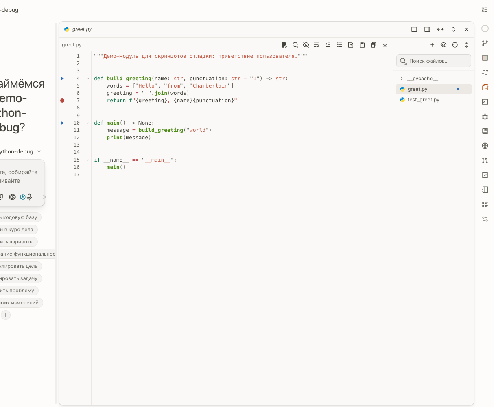

# Python debugging — where the code already is

A broken test used to end in one of two ways: a scroll of pytest output read
line by line, or a detour into an IDE for a real breakpoint. This fork puts
the debugger inside the editor that already has the code open. Upstream
ships no Python debugging at all — the gutter markers, the debug panel and
the server contract below are this fork's work.

[Русская версия](#русская-версия)

## Breakpoints and run arrows in the gutter

In a `.py` file the strip left of the line numbers takes a click, and a
breakpoint appears where you clicked. Top-level defs grow a run arrow:

- a **script** runs as itself, `python <file>`;
- a **test** runs under pytest with its node id, `<file>::<name>`;
- the breakpoints you set ride along with every launch.

A launch from the gutter splits the panel beside the most recently touched
tab and opens the debug surface into the new region, so the run starts
beside the file it runs.

## The debug panel

The panel reads one server-owned **debugpy DAP session** — the run lives and
dies with its process, nothing persists between server starts.

- **Stack and frames**: the call stack with the current frame highlighted;
  the editor gutter marks the execution line while the debuggee is stopped.
- **Stepping**: step over, step into, step out, continue, stop.
- **Variables**: a tree with values; each can be copied.
- **Evaluate**: a field that runs any expression in the stopped frame.
- **Output**: stdout and stderr stream live into the run's log.
- **Tests**: a pytest reporter folds collected nodes, per-test status
  (passed, failed, skipped, error) and tracebacks into the same log — one
  run answers both questions: did it pass, and why not.

## A variable can ride into the chat

The share action on a variable attaches it to the message as a
**debug-variable context part** — the same first-class citizen as a file
quote. The model receives it framed: the dotted path for nested values
(`client.admin_client`), the adapter's type name, where the debuggee stopped
(`file:line`), and the value itself. Ask «why is this empty?» with the value
attached; the agent sees what you saw.

## The interpreter is one setting

Settings → Python debug names the interpreter the debugger launches with.
Leave it empty and each project's own `.venv` wins. The run's launch form
(module or program, args, cwd) is editable from the panel too.

Everything is translated in all shipped locales. The server contract —
routes, the DAP projection, the pytest reporter — is documented in
`packages/web/server/lib/debugger/DOCUMENTATION.md`.

---

# Русская версия

# Отладка Python — там же, где код

Упавший тест раньше заканчивался одним из двух способов: километры вывода
pytest, прочитанные построчно, или крюк в IDE за настоящей точкой останова.
Этот форк ставит отладчик внутрь редактора, в котором код и так открыт. В
апстриме отладки Python нет вообще — маркеры гуттера, панель отладки и
серверный контракт ниже — работа этого форка.

[English](#python-debugging--where-the-code-already-is)

## Точки останова и стрелки запуска в гуттере

В `.py`-файле полоска слева от номеров строк принимает клик — и на этом
месте появляется точка останова. На функциях верхнего уровня растёт стрелка
запуска:

- **скрипт** запускается сам собой, `python <файл>`;
- **тест** — под pytest со своим node id, `<файл>::<имя>`;
- настроенные точки останова едут с каждым запуском.

Запуск из гуттера отрезает панель рядом с последним тронутым табом и
открывает туда поверхность отладки — прогон начинается рядом с файлом,
который он запускает.

## Панель отладки

Панель читает одну серверную **DAP-сессию debugpy** — прогон живёт и умирает
вместе со своим процессом, между рестартами сервера ничего не сохраняется.

- **Стек и кадры**: стек вызовов с подсвеченным текущим кадром; гуттер
  редактора отмечает строку исполнения, пока отлаживаемая программа стоит.
- **Шаги**: step over, step into, step out, продолжение, остановка.
- **Переменные**: дерево со значениями; каждую можно скопировать.
- **Вычисление**: поле, исполняющее любое выражение в остановленном кадре.
- **Вывод**: stdout и stderr текут живьём в лог прогона.
- **Тесты**: pytest-репортер сворачивает собранные узлы, статусы по тестам
  (прошёл, упал, пропущен, ошибка) и трейсбеки в тот же лог — один прогон
  отвечает на оба вопроса сразу: прошёл ли и почему нет.

## Переменная может уехать в чат

Кнопка «поделиться» прикладывает переменную к сообщению как
**контекст-часть «переменная отладки»** — тот же гражданин первого класса,
что и цитата из файла. Модель получает её оформленной: точечный путь для
вложенных значений (`client.admin_client`), имя типа от адаптера, где
отлаживаемая программа остановилась (`файл:строка`), и само значение.
Спросите «почему тут пусто?» с приложенным значением — агент увидит то же,
что видели вы.

## Интерпретатор — одна настройка

Настройки → Отладка Python задают интерпретатор, которым запускается
отладчик. Оставьте поле пустым — и выигрывает `.venv` самого проекта. Форма
запуска (модуль или программа, аргументы, cwd) доступна и из панели.

Всё переведено во всех поставляемых локалях. Серверный контракт — роуты,
DAP-проекция, pytest-репортер — документирован в
`packages/web/server/lib/debugger/DOCUMENTATION.md`.
