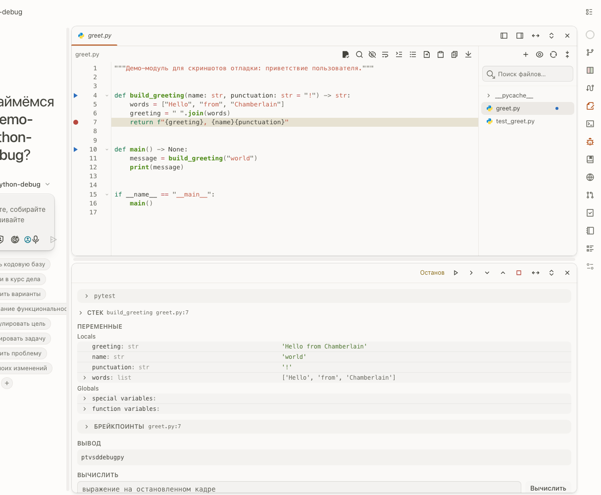

# A workspace you arrange — regions around the chat

Context surfaces open in regions of a per-directory layout tree: panels beside
the chat, splittable, resizable, movable — and the fork's own surfaces ride
that tree with rules upstream's stock app does not need.

[Русская версия](#русская-версия)

## Regions, not one panel column

- Every directory owns its layout tree; each open tab — file, diff, terminal,
  debug, git, browser, team, review — sits in a region of that tree, drag
  and drop between regions, dividers resize the pairs.
- Tabs live in a strip above the regions. A closed region leaves its tabs
  in the strip; a rail click re-opens the surface tab a closed region left
  there — placed by the one rule every open takes, trusting the layout
  tree, never stale bookkeeping.

## Surfaces that join the layout on their own

The fork's panels register as **remount surfaces** on that tree with
unified default widths: Bitbucket, Jira, Confluence, review, team. The one
surface a running program can ask for is the **debug surface**: a debug run
started outside the panel — a chat request through the debugger API —
splits a column under the region of the most recently touched placed tab
and opens the debug tab into the new region. With nothing to sit beside, it
opens by the plain rule, like the rail's click.

## Zone and edge behavior

Zones (`left` / `right` / `bottom` around the chat) hydrate the tree;
dragging a divider rebalances the pair; closing a region keeps its tabs in
the strip and intact until an open places them again. A browser tab is the
one surface that reloads when its element moves regions — an Electron
webview does that; nothing else does.

---

# Русская версия

# Рабочее пространство, которое вы собираете сами — регионы вокруг чата

Контекстные поверхности открываются в регионах дерева раскладки на каждую
директорию: панели рядом с чатом, делимые, ресайзимые, передвижные — и
собственные поверхности форка ездят по этому дереву с правилами, которые
стоковому апстриму не нужны.

[English](#a-workspace-you-arrange--regions-around-the-chat)

## Регионы, а не одна колонка панели

- У каждой директории своё дерево раскладки; каждый открытый таб — файл,
  дифф, терминал, отладка, git, браузер, команда, ревью — сидит в регионе
  этого дерева, drag-and-drop между регионами, разделители ресайзят пару.
- Табы живут в полосе над регионами. Закрытый регион оставляет свои табы в
  полосе; клик по рельсе снова открывает таб поверхности, оставленный
  закрытым регионом, — поставленный тем единственным правилом, по которому
  работает каждое открытие, с доверием дереву раскладки, а не устаревшей
  бухгалтерии.

## Поверхности, которые сами входят в раскладку

Панели форка регистрируются на этом дереве как **remount-поверхности** с
едиными дефолтными ширинами: Bitbucket, Jira, Confluence, ревью, команда. И
есть одна поверхность, которую может попросить работающая программа, —
**поверхность отладки**: запуск отладки, начатый вне панели — запрос из
чата через debugger API — отрезает колонку под регионом последнего
тронутого поставленного таба и открывает туда таб отладки. Когда рядом
нечему стоять, она открывается по обычному правилу, как от клика по
рельсе.

## Зоны и поведение краёв

Зоны (`left` / `right` / `bottom` вокруг чата) оживляют дерево; перетаскивание
разделителя ребалансирует пару; закрытие региона держит табы в полосе
целыми, пока какое-нибудь открытие не пристроит их снова. Таб браузера —
единственная поверхность, которая перегружается при переезде между
регионами: так делает Electron webview; больше ничего.
